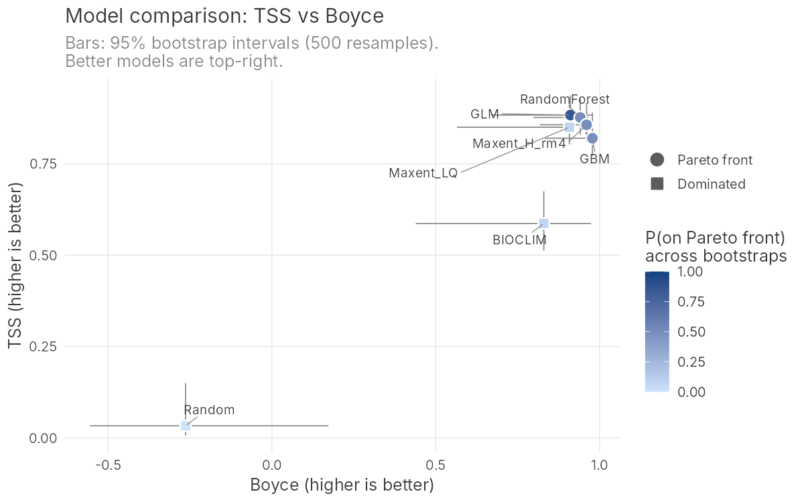
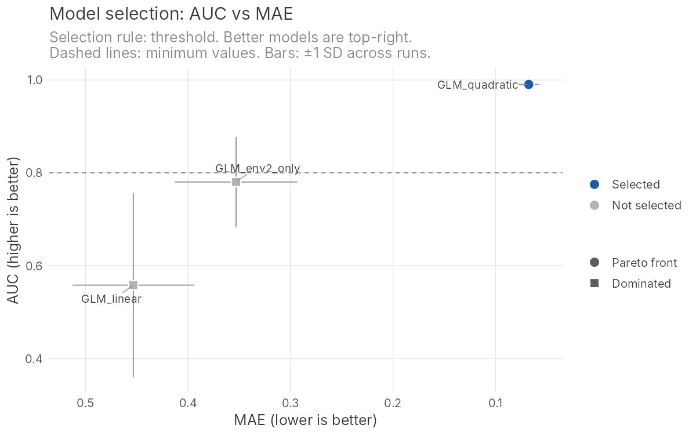

# ENMselect: evaluating and choosing species distribution models with AUC and MAE

<!-- badges: start -->
[](https://github.com/kkonowalik/ENM_evaluation/actions/workflows/R-CMD-check.yaml)
<!-- badges: end -->

This R package implements the model-selection approach from:

> Konowalik, K., Nosol, A. (2021). Evaluation metrics and validation of
> presence-only species distribution models based on distributional maps with
> varying coverage. *Scientific Reports* 11, 1482.
> <https://doi.org/10.1038/s41598-020-80062-1>

One finding of the paper was that **AUC and MAE used together** are a reliable
way to compare models (Figure 6 in the paper). AUC measures how well a model
*ranks* presences above absences. MAE measures how *close* the predicted
suitability values are to what was observed. A model can have an excellent
AUC and still be badly calibrated, and MAE reveals this.

This package turns the original script into a tool anyone can install, and
adds statistics for choosing among models:

| | Original script (2021) | `ENMselect` |
|---|---|---|
| Spatial packages | `raster`, `sp`, `rgdal` (retired in 2023) | **`terra`** (current standard); `sf` objects accepted |
| Input | one raster at a time, fixed CSV columns | many models at once; GeoTIFF paths, `SpatRaster`, CSV, `sf`, GBIF-style columns detected automatically |
| Coordinate systems | had to match manually | points re-projected to each raster automatically |
| Metrics | AUC, MAE, bias via `Metrics` | same values, no extra dependency (checked to be identical), plus TSS and the continuous Boyce index (identical to `ecospat`) |
| Validation | one set of evaluation points | also **spatial block cross-validation** across folds and background sets, and **temporal validation** of hindcasts against fossil or other dated records |
| Model choice | visual inspection of a plot | AUC vs MAE by default, or **any metrics you choose** (including your own); conventional **minimum values** or the **Pareto front** (with a tolerance for ties), compromise distance to the ideal model, **bootstrap** confidence intervals and probability of being on the Pareto front |
| Plot | manual | ready-to-publish `ggplot2` figure |

## Installation

Install R (≥ 4.1) from <https://cran.r-project.org> and, optionally, RStudio
from <https://posit.co/download/rstudio-desktop/>. Then run in R:

```r
install.packages("remotes")
remotes::install_github("kkonowalik/ENM_evaluation")
install.packages("ggrepel")   # optional: neater labels in plots
```

## Quick start with example data

```r
library(ENMselect)

sim <- simulate_enm_data(seed = 1)          # 7 example "models" + points
res <- evaluate_models(sim$models, sim$presence, sim$absence,
                       n_boot = 500, seed = 1)
res
plot_pareto(res)
plot_pareto(res, zoom = TRUE)               # zoom in on the best models
```

```
ENM evaluation: 7 model(s), 100 presence and 300 absence/background points
Bootstrap: 500 resamples, 95% percentile intervals
Criteria: AUC (higher is better), MAE (lower is better)
Pareto front (best trade-offs): Maxent_LQ, GLM, Maxent_H_rm4

 rank        model   AUC AUC_lower AUC_upper   MAE MAE_lower MAE_upper   bias   TSS  Boyce pareto_front p_pareto distance
    1    Maxent_LQ 0.980     0.967     0.990 0.164     0.143     0.185 -0.109 0.850  0.908            1    1.000    0.001
    2          GLM 0.981     0.969     0.991 0.316     0.296     0.336 -0.290 0.883  0.911            1    0.386    0.234
    3 Maxent_H_rm4 0.980     0.968     0.990 0.247     0.231     0.264 -0.146 0.857  0.961            1    0.344    0.128
    4 RandomForest 0.978     0.964     0.989 0.204     0.193     0.216  0.027 0.877  0.941            2    0.352    0.062
    5          GBM 0.968     0.951     0.982 0.239     0.218     0.259 -0.162 0.820  0.978            3    0.028    0.116
    6      BIOCLIM 0.821     0.777     0.863 0.623     0.610     0.637 -0.604 0.587  0.830            4    0.000    0.739
    7       Random 0.457     0.396     0.523 0.522     0.495     0.549 -0.261 0.033 -0.263            4    0.000    0.896
```

In the plots, axes are oriented so that **better models are top-right**: the
MAE axis is reversed because lower MAE is better.


In the zoomed plot, the top five models have overlapping AUC intervals, so
AUC alone cannot separate them. MAE can. `Maxent_LQ` is on the Pareto front in
100% of bootstrap resamples, which makes it a robust choice. `GLM`,
`Maxent_H_rm4` and `RandomForest` reach the front only about a third of the
time.

## Choosing which metrics to compare

AUC vs MAE is the default, but any metric pair, or more than two metrics, can
be compared. Give each criterion a direction: `"max"` (higher is better),
`"min"` (lower is better) or `"zero"` (closer to 0 is better):

```r
# TSS and the Boyce index instead of AUC and MAE
res2 <- evaluate_models(sim$models, sim$presence, sim$absence,
                        criteria = c(TSS = "max", Boyce = "max"),
                        n_boot = 500, seed = 1)
plot_pareto(res2)

# three criteria: AUC, MAE and bias (closer to 0 is better)
res3 <- evaluate_models(sim$models, sim$presence, sim$absence,
                        criteria = c(AUC = "max", MAE = "min", bias = "zero"))
plot_pareto(res3)                         # shows AUC vs MAE, front on all three
plot_pareto(res3, x_metric = "bias")      # any metric on either axis

# your own metric, e.g. the Brier score
brier <- function(obs, pred) mean((obs - pred)^2)
res4 <- evaluate_models(sim$models, sim$presence, sim$absence,
                        metrics = list(Brier = brier),
                        criteria = c(AUC = "max", Brier = "min"))
```



The built-in metrics are `AUC`, `MAE`, `bias`, `TSS` and `Boyce`. A custom
metric is any `function(obs, pred)` that returns one number (`obs` is 0/1,
`pred` the predicted suitability). The same `metrics` argument works in
`evaluate_cv()`, and `select_models()` / `plot_selection()` take the same
`criteria`. The bootstrap gives confidence intervals and `p_pareto` for
whichever criteria you choose.

## Using your own data

You need three things, as before:

1. **Model output rasters**, from Maxent, biomod2, ENMeval, `predicts`,
   `dismo`, or any other software, even outside R. Values should be on a 0–1
   scale (e.g. Maxent *cloglog* or *logistic* output).
2. **Presence points.**
3. **Absence points.** If you have no true absences, use background or
   pseudo-absence points.

```r
library(ENMselect)

models <- c(maxent  = "M:/GIS/models/maxent_model.tif",
            glm     = "M:/GIS/models/glm_model.tif",
            rf      = "M:/GIS/models/rf_model.tif")
# or: models <- terra::rast(list.files("M:/GIS/models", "\\.tif$", full.names = TRUE))

res <- evaluate_models(models,
                       presence = "D:/rs_pres.csv",
                       absence  = "D:/rs_abs.csv",
                       n_boot = 1000, seed = 123)
res
plot_pareto(res)

# Save the results
write.csv(res, "model_evaluation.csv", row.names = FALSE)
ggplot2::ggsave("model_selection.png", plot_pareto(res),
                width = 7, height = 5, dpi = 300)
```

Coordinate columns named `lon/lat`, `longitude/latitude`, `x/y` or
`decimalLongitude/decimalLatitude` (GBIF) are detected automatically. Otherwise
pass `coords = c("my_x_column", "my_y_column")`. Coordinates in a CSV are
assumed to be WGS84 longitude/latitude. If they are not, give the CRS, e.g.
`crs = "EPSG:3035"`. Points that fall on `NA` cells are dropped from all models
(`na_action = "common"`), so every model is compared on the same points. Use
`na_action = "per_model"` to reproduce the original script.

If you already have predicted values at your points, skip the rasters:

```r
tab <- data.frame(obs = c(1, 1, 0, 0, ...),   # 1 = presence, 0 = absence
                  maxent = c(...), glm = c(...))
evaluate_models(data = tab, n_boot = 1000)
```

## Full workflow: spatial cross-validation, fossil validation, selection

`ENMselect` does not fit models: use biomod2, ENMeval, Maxent, tidymodels
or your own code. It takes over at the evaluation and selection stage. A
typical workflow for choosing the algorithms of an ensemble:

1. **Spatial folds.** `spatial_folds()` splits the study area into square
   blocks (side ideally larger than the spatial autocorrelation range of the
   predictors, e.g. from `blockCV::cv_spatial_autocor()`) and assigns them to
   folds with balanced numbers of presences and background points.
2. **Fit models** on all folds but one, for each algorithm, fold and,
   optionally, several background sets. Predict on the held-out fold.
3. **Hold-out metrics.** `evaluate_cv()` computes AUC, MAE, bias, TSS and the
   Boyce index per run and summarises them per algorithm. It also shows
   whether background sets or folds cause more variation, and AUC per fold.
4. **Temporal validation** (optional). `temporal_validation()` checks
   hindcasts against fossil records (see below).
5. **Selection.** `select_models()` keeps every algorithm that reaches
   conventional minimum values (default AUC >= 0.8, TSS >= 0.6), or only the
   Pareto front. `plot_selection()` draws any pair of metrics.

A complete example you can run with the simulated data. It compares three GLMs
on 4 spatial folds and 2 background sets:

```r
library(ENMselect)
sim <- simulate_enm_data(seed = 1, n_presence = 150, n_absence = 600)
pts <- rbind(cbind(sim$presence, occ = 1, set = 0),                  # presences
             cbind(sim$absence, occ = 0, set = rep(1:2, each = 300))) # 2 background sets
pts$fold <- spatial_folds(pts, k = 4, block_size = 100, occ = pts$occ, seed = 1)
pts <- cbind(pts, terra::extract(sim$env, pts[c("lon", "lat")], ID = FALSE))

formulas <- list(GLM_quadratic = occ ~ env1 + I(env1^2) + env2 + I(env2^2),
                 GLM_linear    = occ ~ env1 + env2,
                 GLM_env2_only = occ ~ env2 + I(env2^2))
holdout <- list()
for (s in 1:2) for (f in 1:4) for (a in names(formulas)) {
  d <- pts[pts$set %in% c(0, s), ]              # presences + background set s
  fit <- glm(formulas[[a]], binomial, data = d[d$fold != f, ])
  test <- d[d$fold == f, ]
  holdout[[length(holdout) + 1]] <- data.frame(
    model = a, set = s, fold = f, obs = test$occ,
    pred = predict(fit, test, type = "response"))
}
cv <- evaluate_cv(do.call(rbind, holdout), set = "set")
cv
sel <- select_models(cv, min_metrics = c(AUC = 0.8, TSS = 0.6))
sel
plot_selection(sel)                       # AUC vs MAE
plot_selection(sel, x_metric = "TSS")     # AUC vs TSS
```



The input to `evaluate_cv()` is a simple long table: one row per held-out
point and run, with columns `model`, `fold`, `obs` (1/0), `pred` and,
optionally, `set`. Any modelling software's output can be put in this form.
With biomod2, for example, project the cross-validation models on the
evaluation points and keep, for each run, the points of its held-out fold.

### Fossil (temporal) validation

Hindcasts can be tested against dated records, such as fossils or pollen.
Records have no true absences, so each record is compared with background
cells *of the same time slice*. Its score is the proportion of those cells
with lower predicted suitability (0.5 = random, 1 = perfect). A record
spanning several slices, e.g. a 1000-year bin matched to ten 100-year
TraCE21k slices, gets its mean score. The mean over records is a "fossil
AUC".

```r
# sites: one row per record x time slice x model (x run), with the prediction
#        under that slice's climate, e.g. columns record, slice, model, run,
#        period, novel, pred
# bg:    the same for background cells (same cells in every slice): slice,
#        model, run, pred
fos <- temporal_validation(
  sites, bg, run = "run", period = "period", novel = "novel",
  combine = list(deep = c("Lateglacial", "Glacial")),  # the periods that matter
  thresholds = thr,       # optional: 10% presence threshold per model and run
  prefix = "fossil")
all <- merge(cv, fos, by = "model")
sel <- select_models(all,
                     min_metrics = c(AUC = 0.8, TSS = 0.6, fossil_AUC_deep = 0.7),
                     criteria = c(AUC = "max", MAE = "min", fossil_AUC_deep = "max"),
                     tol = 0.01)
plot_selection(sel, x_metric = "AUC", y_metric = "fossil_AUC_deep")
```

Helpers for preparing the climate of each record:

- `anomaly_climate()`: past climate = high-resolution present (e.g. CHELSA)
  plus the climate-model anomaly (past minus the model's present). It uses a
  ratio for precipitation and works on point tables (fast) or rasters.
- `outside_range()`: flags non-analog climates (outside the calibration
  range). The `fossil_AUC_analog` score ignores them.
- `age_to_period()`: Holocene / Lateglacial / Glacial from ages in cal BP.
- `threshold_p10()`: the 10th-percentile training presence threshold, for
  sensitivity.

## How the selection works

1. **Metrics.** For each model, compute **AUC** (Mann–Whitney formulation,
   higher is better), **MAE** (`mean(|obs − pred|)`, lower is better),
   **bias** (`mean(obs − pred)`, closer to 0 is better), **TSS** and the
   **Boyce index**. AUC and MAE are the default criteria; see
   [Choosing which metrics to compare](#choosing-which-metrics-to-compare).
2. **Pareto front.** Model A *dominates* model B if A is at least as good on
   every criterion (by default AUC and MAE) and strictly better on one.
   Models that no other model dominates form the **Pareto front**. These are
   the defensible choices, each a different trade-off. With `tol`,
   differences smaller than the tolerance count as ties. Dominated models can be discarded.
   Repeating the procedure on the remaining models gives fronts 2, 3, …
   (non-dominated sorting).
3. **Compromise distance.** The criteria are rescaled to 0–1 and each
   model's distance to the *ideal point* (the best value of every criterion)
   is computed. Use it to
   pick one model from the front. `weights = c(AUC = 2, MAE = 1)` makes AUC
   count twice as much.
4. **Bootstrap robustness.** Presence and absence points are resampled with
   replacement (stratified) `n_boot` times and everything is recomputed. This
   gives confidence intervals for each criterion and **`p_pareto`**, the
   proportion of resamples in which a model is on the Pareto front. Small
   differences between models are often within sampling noise, and
   `p_pareto` shows how much your choice depends on the particular evaluation
   points.
5. **Final `rank`.** Models are ordered by Pareto front, then `p_pareto`, then
   distance.

`pareto_rank()` works on any table with any number of criteria, e.g. metrics
computed elsewhere such as AICc or omission rates:

```r
pareto_rank(my_table, maximize = c("AUC", "TSS"), minimize = c("MAE", "AICc"),
            zero = "bias")
```

## Upgrading from the original script

If you only need the metrics for one raster, this is the original code
translated to current packages:

```r
library(terra)
r    <- rast("M:/GIS/models/maxent_model.tif")
pres <- read.csv("D:/rs_pres.csv")[, 2:3]
abs  <- read.csv("D:/rs_abs.csv")[, 2:3]
pts  <- vect(rbind(setNames(pres, c("x", "y")), setNames(abs, c("x", "y"))),
             geom = c("x", "y"), crs = "EPSG:4326")
obs  <- c(rep(1, nrow(pres)), rep(0, nrow(abs)))
pred <- extract(r, project(pts, r), ID = FALSE)[[1]]
ok   <- !is.na(pred)

ENMselect::auc_score(obs[ok], pred[ok])
ENMselect::mae_score(obs[ok], pred[ok])
ENMselect::bias_score(obs[ok], pred[ok])
```

## Citation

If you use this method, please cite the paper (`citation("ENMselect")`):

> Konowalik, K., Nosol, A. (2021). Evaluation metrics and validation of
> presence-only species distribution models based on distributional maps with
> varying coverage. *Scientific Reports* 11, 1482.
> <https://doi.org/10.1038/s41598-020-80062-1>
> (free to read: <https://rdcu.be/cjB5b>)

Thanks and good luck with modelling!
