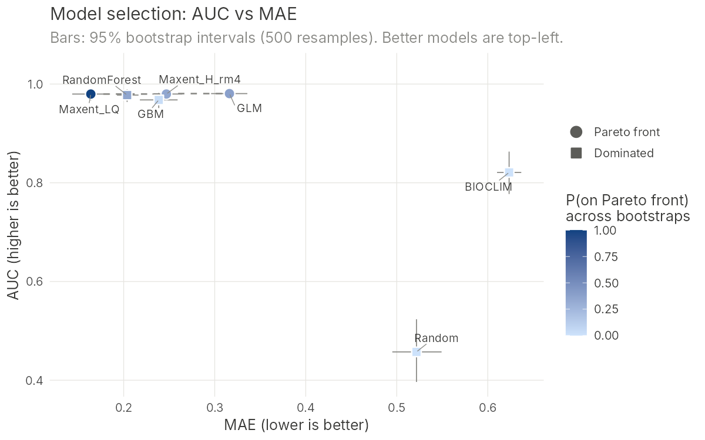
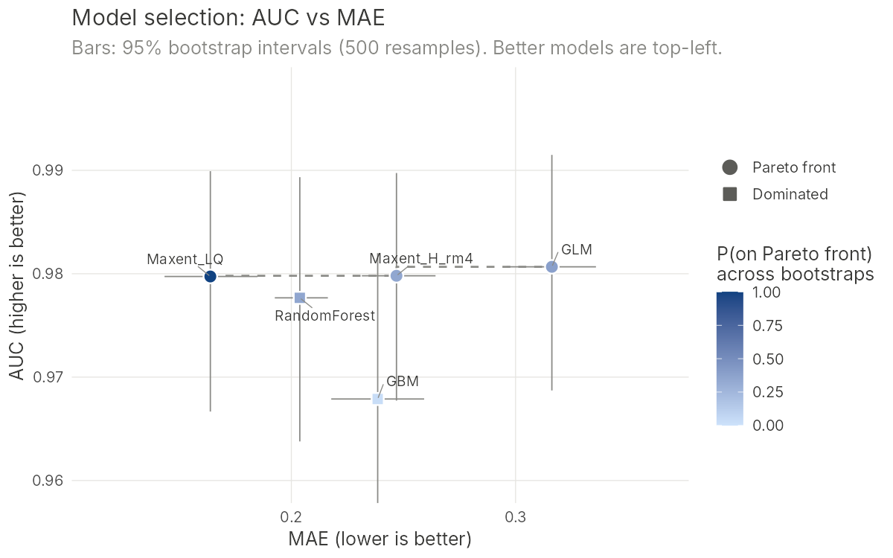

# enmpareto: choosing species distribution models with AUC, MAE and Pareto optimality

<!-- badges: start -->
[](https://github.com/kkonowalik/ENM_evaluation/actions/workflows/R-CMD-check.yaml)
<!-- badges: end -->

This R package implements the model-selection approach from:

> Konowalik, K., Nosol, A. (2021). Evaluation metrics and validation of
> presence-only species distribution models based on distributional maps with
> varying coverage. *Scientific Reports* 11, 1482.
> <https://doi.org/10.1038/s41598-020-80062-1>

One finding of the paper was that **AUC and MAE used together** are a reliable
way to compare models (Figure 6 in the paper). AUC measures how well a model
*ranks* presences above absences. MAE measures how *close* the predicted
suitability values are to what was observed. A model can have an excellent
AUC and still be badly calibrated, and MAE reveals this.

This package turns the original script into a tool anyone can install, and
adds statistics for choosing among models:

| | Original script (2021) | `enmpareto` |
|---|---|---|
| Spatial packages | `raster`, `sp`, `rgdal` (retired in 2023) | **`terra`** (current standard); `sf` objects accepted |
| Input | one raster at a time, fixed CSV columns | many models at once; GeoTIFF paths, `SpatRaster`, CSV, `sf`, GBIF-style columns detected automatically |
| Coordinate systems | had to match manually | points re-projected to each raster automatically |
| Metrics | AUC, MAE, bias via `Metrics` | same values, no extra dependency (checked to be identical) |
| Model choice | visual inspection of a plot | **Pareto front**, compromise distance to the ideal model, **bootstrap** confidence intervals and probability of being on the Pareto front |
| Plot | manual | ready-to-publish `ggplot2` figure |

## Installation

Install R (≥ 4.1) from <https://cran.r-project.org> and, optionally, RStudio
from <https://posit.co/download/rstudio-desktop/>. Then run in R:

```r
install.packages("remotes")
remotes::install_github("kkonowalik/ENM_evaluation")
install.packages("ggrepel")   # optional: neater labels in plots
```

## Quick start with example data

```r
library(enmpareto)

sim <- simulate_enm_data(seed = 1)          # 7 example "models" + points
res <- evaluate_models(sim$models, sim$presence, sim$absence,
                       n_boot = 500, seed = 1)
res
plot_pareto(res)
plot_pareto(res, zoom = TRUE)               # zoom in on the best models
```

```
ENM evaluation: 7 model(s), 100 presence and 300 absence/background points
Bootstrap: 500 resamples, 95% percentile intervals
Pareto front (best AUC/MAE trade-offs): Maxent_LQ, GLM, Maxent_H_rm4

 rank        model   AUC AUC_lower AUC_upper   MAE MAE_lower MAE_upper   bias pareto_front p_pareto distance
    1    Maxent_LQ 0.980     0.967     0.990 0.164     0.143     0.185 -0.109            1    1.000    0.001
    2          GLM 0.981     0.969     0.991 0.316     0.296     0.336 -0.290            1    0.386    0.234
    3 Maxent_H_rm4 0.980     0.968     0.990 0.247     0.231     0.264 -0.146            1    0.344    0.128
    4 RandomForest 0.978     0.964     0.989 0.204     0.193     0.216  0.027            2    0.352    0.062
    5          GBM 0.968     0.951     0.982 0.239     0.218     0.259 -0.162            3    0.028    0.116
    6      BIOCLIM 0.821     0.777     0.863 0.623     0.610     0.637 -0.604            4    0.000    0.739
    7       Random 0.457     0.396     0.523 0.522     0.495     0.549 -0.261            4    0.000    0.896
```




In the zoomed plot, the top five models have overlapping AUC intervals, so
AUC alone cannot separate them. MAE can. `Maxent_LQ` is on the Pareto front in
100% of bootstrap resamples, which makes it a robust choice. `GLM`,
`Maxent_H_rm4` and `RandomForest` reach the front only about a third of the
time.

## Using your own data

You need three things, as before:

1. **Model output rasters**, from Maxent, biomod2, ENMeval, `predicts`,
   `dismo`, or any other software, even outside R. Values should be on a 0–1
   scale (e.g. Maxent *cloglog* or *logistic* output).
2. **Presence points.**
3. **Absence points.** If you have no true absences, use background or
   pseudo-absence points.

```r
library(enmpareto)

models <- c(maxent  = "M:/GIS/models/maxent_model.tif",
            glm     = "M:/GIS/models/glm_model.tif",
            rf      = "M:/GIS/models/rf_model.tif")
# or: models <- terra::rast(list.files("M:/GIS/models", "\\.tif$", full.names = TRUE))

res <- evaluate_models(models,
                       presence = "D:/rs_pres.csv",
                       absence  = "D:/rs_abs.csv",
                       n_boot = 1000, seed = 123)
res
plot_pareto(res)

# Save the results
write.csv(res, "model_evaluation.csv", row.names = FALSE)
ggplot2::ggsave("model_selection.png", plot_pareto(res),
                width = 7, height = 5, dpi = 300)
```

Coordinate columns named `lon/lat`, `longitude/latitude`, `x/y` or
`decimalLongitude/decimalLatitude` (GBIF) are detected automatically. Otherwise
pass `coords = c("my_x_column", "my_y_column")`. Coordinates in a CSV are
assumed to be WGS84 longitude/latitude. If they are not, give the CRS, e.g.
`crs = "EPSG:3035"`. Points that fall on `NA` cells are dropped from all models
(`na_action = "common"`), so every model is compared on the same points. Use
`na_action = "per_model"` to reproduce the original script.

If you already have predicted values at your points, skip the rasters:

```r
tab <- data.frame(obs = c(1, 1, 0, 0, ...),   # 1 = presence, 0 = absence
                  maxent = c(...), glm = c(...))
evaluate_models(data = tab, n_boot = 1000)
```

## How the selection works

1. **Metrics.** For each model, compute **AUC** (Mann–Whitney formulation,
   higher is better), **MAE** (`mean(|obs − pred|)`, lower is better) and
   **bias** (`mean(obs − pred)`, closer to 0 is better).
2. **Pareto front.** Model A *dominates* model B if A is at least as good on
   both AUC and MAE and strictly better on one. Models that no other model
   dominates form the **Pareto front**. These are the defensible choices,
   each a different AUC/MAE trade-off. Dominated models can be discarded.
   Repeating the procedure on the remaining models gives fronts 2, 3, …
   (non-dominated sorting).
3. **Compromise distance.** AUC and MAE are rescaled to 0–1 and each model's
   distance to the *ideal point* (best AUC and best MAE) is computed. Use it to
   pick one model from the front. `weights = c(AUC = 2, MAE = 1)` makes AUC
   count twice as much.
4. **Bootstrap robustness.** Presence and absence points are resampled with
   replacement (stratified) `n_boot` times and everything is recomputed. This
   gives confidence intervals for AUC and MAE and **`p_pareto`**, the
   proportion of resamples in which a model is on the Pareto front. Small
   differences in AUC/MAE between models are often within sampling noise, and
   `p_pareto` shows how much your choice depends on the particular evaluation
   points.
5. **Final `rank`.** Models are ordered by Pareto front, then `p_pareto`, then
   distance.

`pareto_rank()` works on any table with any number of criteria, so you can add
TSS, the Boyce index, AICc, omission rates or other metrics:

```r
pareto_rank(my_table, maximize = c("AUC", "TSS"), minimize = c("MAE", "AICc"))
```

## Upgrading from the original script

If you only need the metrics for one raster, this is the original code
translated to current packages:

```r
library(terra)
r    <- rast("M:/GIS/models/maxent_model.tif")
pres <- read.csv("D:/rs_pres.csv")[, 2:3]
abs  <- read.csv("D:/rs_abs.csv")[, 2:3]
pts  <- vect(rbind(setNames(pres, c("x", "y")), setNames(abs, c("x", "y"))),
             geom = c("x", "y"), crs = "EPSG:4326")
obs  <- c(rep(1, nrow(pres)), rep(0, nrow(abs)))
pred <- extract(r, project(pts, r), ID = FALSE)[[1]]
ok   <- !is.na(pred)

enmpareto::auc_score(obs[ok], pred[ok])
enmpareto::mae_score(obs[ok], pred[ok])
enmpareto::bias_score(obs[ok], pred[ok])
```

## Citation

If you use this method, please cite the paper (`citation("enmpareto")`):

> Konowalik, K., Nosol, A. (2021). Evaluation metrics and validation of
> presence-only species distribution models based on distributional maps with
> varying coverage. *Scientific Reports* 11, 1482.
> <https://doi.org/10.1038/s41598-020-80062-1>
> (free to read: <https://rdcu.be/cjB5b>)

Thanks and good luck with modelling!
